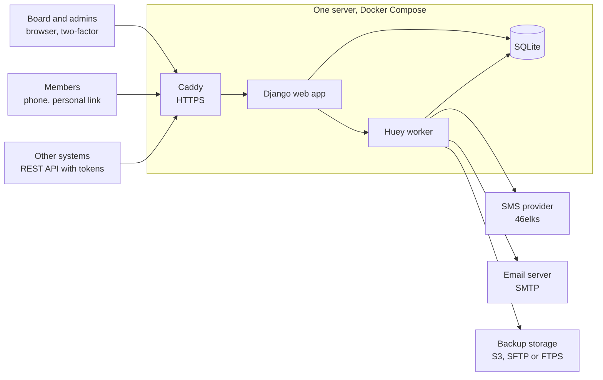
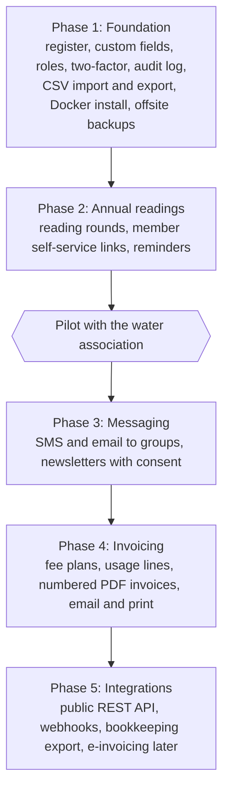

# Architecture

Agreed plan for SmallCompanyRegister, October 2026. Changes to the decisions
below need the maintainer's approval.

## Summary

One open source web app in **Python with Django and SQLite**, shipped as a
Docker Compose bundle that runs on a small VPS or a Raspberry Pi. Every part
is free software; the only unavoidable running cost is SMS, which every
provider charges per message.

Django gives us, well tested and for free: login with roles and two-factor,
an admin interface, database migrations, translations (Swedish and English
first, others later) and a mature REST API toolkit. That leaves our effort
for what makes the product useful: configurable records, annual readings,
invoicing and messaging.

The water association is the first configuration, not the design. A
"household with a meter that reports yearly usage and pays a yearly fee" is
set up through settings, so a sports club or a small company can configure
their own record types instead.

## Stack and hosting

Three containers in one Docker Compose file: the web app, a background
worker and a Caddy reverse proxy that handles HTTPS automatically. Web app
and worker share one data volume holding the SQLite databases and uploads.

Everything personal stays on the organisation's own server; the worker only
hands outgoing messages and encrypted backups to outside services.

| Part | Choice | Why |
| --- | --- | --- |
| Language and framework | Python 3.13, Django 5.2 LTS | Login, roles, admin, migrations and translations built in |
| User interface | Server-rendered pages with HTMX | Fast to build, no separate frontend project, works on phones |
| Database | SQLite in WAL mode | No database server to run, JSON fields for custom data, one file to back up |
| Background jobs | Huey with SQLite storage | Sends SMS, email and backups, and runs scheduled jobs, without Redis |
| API | Django REST Framework with an OpenAPI description | Other systems read and write records with tokens |
| PDFs | WeasyPrint | Invoices and letters from HTML templates, for email and print |
| Backups | rclone, triggered by the worker | One tool covers S3, SFTP and FTPS, with encryption |
| Web server | Caddy | Free HTTPS certificates with no setup |
| Licence | MIT | Anyone can use, change and self-host it |

Running cost for a 50-household association is a small VPS (or hardware they
already own) plus SMS credits.

PostgreSQL would only pay off with many simultaneous writers or one install
hosting many organisations. Django hides most database differences, so a
later switch is a settings change plus a data migration.

## Data model

The model separates **what is registered** (a household, a member, a client
company) from **who you contact** (people), so one household can have
several contacts and one person can belong to several units.

| Entity | Holds | Water example |
| --- | --- | --- |
| Organisation | Name, business ID, VAT number, bank account, language, invoice settings | The water company |
| Unit type | A configurable kind of record, with its own custom fields | "Household" with "Property ID" and "Meter number" |
| Unit | One registered thing: name, address, status, start and end dates, custom field values | Household at Byvägen 4 |
| Person | Name, email, phone, address, preferred channel, consents | The owner and a co-owner |
| Role | Links a person to a unit: owner, billing contact, contact | Owner receives invoices |
| Tag or group | Free labels for filtering and mailing lists | "Village north", "Board" |
| Reading type and reading | A periodic value with unit, period and who submitted it | Yearly water usage in m³ |
| Fee plan | A recurring charge: amount, interval, VAT, which units it applies to | Base fee per year plus price per m³ |
| Invoice, line, payment | Numbered invoices, reference numbers, paid status | Annual invoice 2026 |
| Message and campaign | Sent SMS, emails and newsletters with delivery status | Spring meter-reading reminder |
| Audit log | Who changed or viewed what, and when | GDPR accountability |

Custom fields are defined by an admin (text, number, date, choice, yes/no)
and stored as validated JSON on the unit or person. That is how the same app
serves a water company, a club or a small business without code changes.

## Modules

Each module is a separate Django app, so an organisation can switch off what
it does not use (for example invoicing).

1. **Register.** Searchable, filterable list of units and people; add, edit
   and archive; CSV import and export; roles for admin, board, treasurer and
   read-only.
2. **Readings and self-service.** Each year the app sends every household a
   personal link by SMS or email. The member opens it on their phone, enters
   the meter value and can check their own contact details. No member
   passwords; links expire.
3. **Messaging.** SMS or email to everyone, a tag or a filtered list, with
   templates and placeholders. A provider interface keeps SMS vendors
   swappable.
4. **Newsletters.** Composed in the app, sent by email in throttled batches,
   with an unsubscribe link and consent tracked per person.
5. **Invoicing.** Fee plans generate invoices per period, adding usage-based
   lines from readings. Each invoice gets a sequential number and a bank
   reference, renders to PDF, and goes out by email or to a print batch.
   Payments are marked manually, or imported from a bank file later.
6. **API and integrations.** REST API with scoped tokens, outgoing webhooks
   on events (member added, invoice paid), exports for bookkeeping software.
7. **Backups.** Nightly encrypted copy of the SQLite file (taken with
   SQLite's online backup while the app runs) plus uploads, pushed to
   S3-compatible storage, SFTP or FTPS. Last backup status on the dashboard
   and a documented restore command.
8. **Privacy tools.** Export everything about one person, erase or
   anonymise them, and run retention rules automatically.

## Nordic compliance

GDPR is the main law to design for and is the same in all Nordic countries;
bookkeeping and invoicing rules differ per country and become settings.
These points are from general knowledge, not legal advice, and must be
checked before the first real installation.

| Area | What the app does |
| --- | --- |
| GDPR legal basis | Each data field has a documented purpose. Membership data rests on the membership agreement; marketing needs consent. |
| Data subject rights | One-click export of a person's data, correction through self-service, erasure or anonymisation when no other law requires keeping it. |
| Accountability | Audit log of changes and data views, a processing record template, role-based access so only the treasurer sees invoices. |
| Security | HTTPS only, two-factor login for admins, encrypted backups, hashed passwords, no data to third parties without a configured processor. |
| Data location | Self-hosted by default. Recommended SMS, email and backup providers are EU-based. |
| Bookkeeping retention | Sent invoices and payments are locked and kept for the country's period, approximately: Finland 6 years for vouchers and 10 for books, Sweden 7, Norway 5, Denmark 5. Other personal data is deleted earlier. |
| Invoice content | Sequential numbering, seller business ID and VAT number, VAT per rate, due date, national reference number (Finnish reference, Swedish OCR, Norwegian KID, Danish FIK). Optional SEPA payment QR code. |
| E-invoicing | Not needed for households. A later Finvoice or Peppol integration covers business clients who demand e-invoices. |
| Newsletters and SMS marketing | Consent recorded with date and source, unsubscribe in every message, service messages kept separate from marketing. |
| Accessibility | WCAG 2.1 AA, so the self-service form works with screen readers and on phones. |

Åland is outside the EU VAT area, so VAT settings must allow an organisation
to be VAT-exempt or use different rules per installation.

## SMS and email providers

SMS starts with **46elks** (Sweden, pay per message, simple REST API) and
email with plain **SMTP**, both behind a small provider interface so an
installation can switch with a setting. Alternatives: GatewayAPI (Denmark)
or Sinch (Sweden) for SMS; Brevo or Mailjet (France, free tiers) for
newsletters.

## Roadmap

The API is built into every phase, since pages and API share models and
permissions; phase 5 opens it to outside systems.

## Phase 1 build plan

Phase 1 is done when an admin can install with `docker compose up`, set up
the water association, import 50 households from CSV, search and edit them,
and see a nightly encrypted backup land on S3 or SFTP. It ships as five pull
requests.

| PR | Contents | Done when |
| --- | --- | --- |
| 1. Skeleton | Django 5.2 LTS, uv, ruff, pytest, GitHub Actions CI, MIT licence, README, Swedish and English translations, SQLite in WAL mode, Dockerfile and Compose with web, worker and Caddy | `docker compose up` shows a translated start page and CI is green |
| 2. Register | Organisation settings, unit types with custom fields, units, people, roles, tags; searchable list, add, edit and archive pages with HTMX | An admin can create the "Household" type and register households with contacts |
| 3. Access and audit | Two-factor login for admins, roles for admin, board, treasurer and read-only, audit log of changes and views | Each role sees only what it should; every change is logged |
| 4. CSV import and export | Upload, map columns, preview with validation errors, import; export any filtered list | 50 households import cleanly, and bad rows are reported, not skipped silently |
| 5. Backups | SQLite online backup, encrypted with rclone, sent to S3, SFTP or FTPS nightly; dashboard status; documented restore | A restore from last night's backup brings the register back on a fresh install |

A sample "water association" configuration ships as a ready-made setup that
can be loaded on first start.

## Phase 2 build plan

Phase 2 is done when the board can open a reading round, send every
household a personal link by SMS or email (or print a letter for those with
neither), and see who has reported and who needs a reminder. It ships as
four pull requests; the last one adds the plugin core (see
[Plugins](#plugins)).

| PR | Contents | Done when |
| --- | --- | --- |
| 7. Readings | Reading types set up by an admin (unit of measure, decimals, cumulative meter), reading rounds, one reading per unit and round; usage from the previous reading with warnings for values that look wrong; round progress with a filter for missing units; entry and correction from the round and the unit page; history from the audit log; CSV export | The board enters 50 households' meter readings for 2026 and exports the round |
| 8. Self-service links | Personal links with a random token stored only as a hash, expiring and revocable; a public, mobile-first page where a member enters the reading and corrects their own contact details; changes logged with the link; printable letters with a QR code | A member opens the link on a phone, reports the meter, fixes their email, and the board sees it |
| 9. Sending links and reminders | A messaging app with a provider interface (SMTP email, 46elks SMS, console for development), message records with delivery status, editable templates, sending a round's links and reminders to missing units through the worker | Links go out by SMS, falling back to email, falling back to the print list, and a reminder reaches only those who have not reported |
| 10. Plugin core | Entry-point loader, `SCR_PLUGINS`, hook registry with the first extension points (navigation, unit and person panels, messaging providers), example plugin and docs | The example plugin, enabled with `SCR_PLUGINS`, adds a menu item, a unit panel and an SMS provider, and the tests load it |

### Readings

A **reading type** says what is read from which unit type, for example
"Vattenmätare" in m³ from households. For a cumulative meter the usage of a
round is the value minus the unit's most recent earlier reading of the same
type (rounds without a reading are skipped). A value lower than the previous
one, or a usage more than three times the unit's average over its last three
rounds, is saved but marked for a check. A round expects every active,
non-archived unit of the type, plus any unit that has a reading in it.

### Self-service links

A link holds a random 256-bit token. Only its SHA-256 hash is stored, so the
token exists only in the letter or message that carries it, and a copy of
the database cannot open anyone's page. A link belongs to one unit, one
person and optionally a round. It expires at the end of the round's closing
day, or after `SCR_SELF_SERVICE_LINK_DAYS`, and can be stopped. Changes made
through a link are applied directly and audit-logged with the link's id in
`additional_data`. Links, and the audit entries they produce, are personal
data of the person they belong to, so the export and erasure tools (module
8) must include them. Member pages are rate-limited with Django's cache (files
under `SCR_DATA_DIR`, no extra service), with stricter limits for unknown
tokens.

### Messaging

`apps.messaging` keeps a record of every message (channel, recipient,
text, status, the provider's id), grouped in send-outs. Providers are
classes registered by channel and name in `apps.messaging.registry`; an
installation picks one per channel by setting. The registry is the
messaging extension point that the plugin core (PR 10) opens to plugins.
Built-in: email through Django (SMTP or console), SMS through 46elks, and
console and dummy SMS providers for development and tests. Sending runs in
Huey tasks. A link's token is only in the message that goes out; the
stored copy has a placeholder. Messages are personal data of their
recipient and are covered by the export and erasure tools. Phase 3 builds
group messaging on the same records and providers.

## Phase 3 build plan

Phase 3 is done when an admin can send an urgent alert to every household
in a minute, visitors find the organisation's contact details on its public
page, and members can subscribe to newsletters and unsubscribe from them.

| PR | Contents | Done when |
| --- | --- | --- |
| 11. Messages and urgent alerts | Staff write one message to everyone, a tag, a unit type or the filtered unit list (all contacts or main contact only) by SMS, email or both; recipient and SMS counts and a confirmation step; urgent alert mode on both channels with a list of who cannot be reached; live delivery status | A water-leak alert reaches every household with a phone or email, and the board knows whom to call |
| 12. Public organisation page | Public contact fields and logo in organisation settings; a translated, mobile-first landing page at `/` (can be switched off, the only page search engines may index); a notice banner an alert can publish; the contact block on member pages, in letters and as message placeholders | A visitor on a phone finds the emergency number and the current notice |
| 13. Newsletters with consent | Per-person consent with time and source, changeable on the self-service page; newsletters by email to consenting people only, with an unsubscribe link in every one | A newsletter reaches only those who said yes, and one click unsubscribes |

Messages and alerts in PR 11 are service messages about the organisation's
own service, sent on the basis of membership, so they need no marketing
consent. Newsletters (PR 13) do.

## Plugins

Organisations can extend the app without forking it.

- **A plugin is a normal Python package** that can be installed with pip and
  is a Django app.
- **Discovery and enabling.** Plugins are found through the Python entry
  point group `scr.plugins` and enabled per installation with
  `SCR_PLUGINS`, a comma-separated list. Nothing loads unless it is listed.
- **Docker.** The image installs extra packages listed in
  `SCR_PLUGIN_PACKAGES` at build time, or the user builds a derived image
  `FROM` ours.
- **Django integration.** Settings appends the enabled plugins to
  `INSTALLED_APPS`, so their migrations, templates, static files and
  translations work as for any app.
- **Hook registry.** A small in-house registry, with no new dependency, gives
  named extension points:
  - navigation items
  - panels on unit and person pages
  - custom field types
  - SMS and email providers
  - backup targets
  - CSV import and export formats
  - reading validators
  - invoice line generators (phase 4)
  - API routes and webhook events (phase 5)

  For model events, plugins use ordinary Django signals.
- **Trust.** Plugins run with full trust, like any other installed code.
  Only install plugins you trust. A plugin must declare which personal data
  it stores, so the export and erasure tools cover it.
- **Example.** A minimal example plugin lives in the repository
  (`plugins/example`) and is used in the tests.

How to install, enable and write plugins is in [plugins.md](plugins.md).

The plugin core ships in phase 2 (PR 10) with the first extension points:
navigation, unit and person panels, and messaging providers. Every later
phase adds its own extension points as it builds the feature they hook into.
