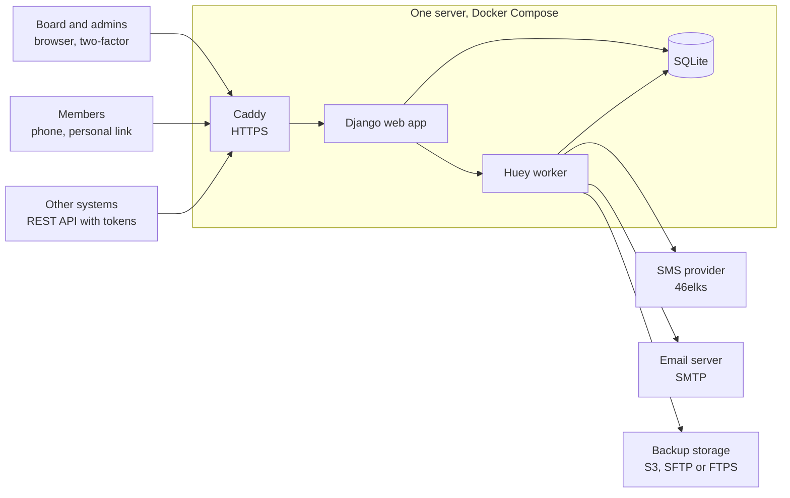

# Architecture

Agreed plan for Metra, October 2026. Changes to the decisions
below need the maintainer's approval.

## Summary

One open source web app in **Python with Django and SQLite**, shipped as a
Docker Compose bundle that runs on a small VPS or a Raspberry Pi. Every part
is free software; the only unavoidable running cost is SMS, which every
provider charges per message.

Django gives us, well tested and for free: login with roles and two-factor,
an admin interface, database migrations, translations (Swedish and English
first, then a machine-translated Finnish, others later) and a mature REST API toolkit. That leaves our effort
for what makes the product useful: configurable records, annual readings,
invoicing and messaging.

The water association is the first configuration, not the design. A
"household with a meter that reports yearly usage and pays a yearly fee" is
set up through settings, so a sports club or a small company can configure
their own record types instead.

## Stack and hosting

Three containers in one Docker Compose file: the web app, a background
worker and a Caddy reverse proxy that handles HTTPS automatically. Web app
and worker share one data volume holding the SQLite databases and uploads.

Everything personal stays on the organisation's own server; the worker only
hands outgoing messages and encrypted backups to outside services.

| Part | Choice | Why |
| --- | --- | --- |
| Language and framework | Python 3.13, Django 5.2 LTS | Login, roles, admin, migrations and translations built in |
| User interface | Server-rendered pages with HTMX | Fast to build, no separate frontend project, works on phones |
| Database | SQLite in WAL mode | No database server to run, JSON fields for custom data, one file to back up |
| Background jobs | Huey with SQLite storage | Sends SMS, email and backups, and runs scheduled jobs, without Redis |
| API | Django REST Framework with an OpenAPI description | Other systems read and write records with tokens |
| PDFs | WeasyPrint | Invoices and letters from HTML templates, for email and print |
| Backups | rclone, triggered by the worker | One tool covers S3, SFTP and FTPS, with encryption |
| Web server | Caddy | Free HTTPS certificates with no setup |
| Licence | MIT | Anyone can use, change and self-host it |

Running cost for a 50-household association is a small VPS (or hardware they
already own) plus SMS credits.

PostgreSQL would only pay off with many simultaneous writers or one install
hosting many organisations. Django hides most database differences, so a
later switch is a settings change plus a data migration.

## Data model

The model separates **what is registered** (a household, a member, a client
company) from **who you contact** (people), so one household can have
several contacts and one person can belong to several units.

| Entity | Holds | Water example |
| --- | --- | --- |
| Organisation | Name, business ID, VAT number, bank account, language, invoice settings | The water company |
| Unit type | A configurable kind of record, with its own custom fields | "Household" with "Property ID" and "Meter number" |
| Unit | One registered thing: name, address, status, start and end dates, custom field values | Household at Byvägen 4 |
| Person | Name, email, phone, address, preferred channel, consents | The owner and a co-owner |
| Role | Links a person to a unit: owner, billing contact, contact | Owner receives invoices |
| Tag or group | Free labels for filtering and mailing lists | "Village north", "Board" |
| Reading type and reading | A periodic value with unit, period and who submitted it | Yearly water usage in m³ |
| Fee plan | A recurring charge: amount, interval, VAT, which units it applies to | Base fee per year plus price per m³ |
| Invoice, line, payment | Numbered invoices, reference numbers, paid status | Annual invoice 2026 |
| Message and campaign | Sent SMS, emails and newsletters with delivery status | Spring meter-reading reminder |
| Audit log | Who changed or viewed what, and when | GDPR accountability |

Custom fields are defined by an admin (text, number, date, choice, yes/no)
and stored as validated JSON on the unit or person. That is how the same app
serves a water company, a club or a small business without code changes.

## Modules

Each module is a separate Django app, so an organisation can switch off what
it does not use (for example invoicing).

1. **Register.** Searchable, filterable list of units and people; add, edit
   and archive; CSV import and export; roles for admin, board, treasurer and
   read-only.
2. **Readings and self-service.** Each year the app sends every household a
   personal link by SMS or email. The member opens it on their phone, enters
   the meter value and can check their own contact details. No member
   passwords; links expire.
3. **Messaging.** SMS or email to everyone, a tag or a filtered list, with
   templates and placeholders. A provider interface keeps SMS vendors
   swappable.
4. **Newsletters.** Composed in the app, sent by email in throttled batches,
   with an unsubscribe link and consent tracked per person.
5. **Invoicing.** Fee plans generate invoices per period, adding usage-based
   lines from readings. Each invoice gets a sequential number and a bank
   reference, renders to PDF, and goes out by email or to a print batch.
   Payments are marked manually, or imported from a bank file later.
6. **API and integrations.** REST API with scoped tokens, outgoing webhooks
   on events (member added, invoice paid), exports for bookkeeping software.
7. **Backups.** Nightly encrypted copy of the SQLite file (taken with
   SQLite's online backup while the app runs) plus uploads, pushed to
   S3-compatible storage, SFTP or FTPS. Last backup status on the dashboard
   and a documented restore command.
8. **Privacy tools.** Export everything about one person, erase or
   anonymise them, and run retention rules automatically.

## Nordic compliance

GDPR is the main law to design for and is the same in all Nordic countries;
bookkeeping and invoicing rules differ per country and become settings.
These points are from general knowledge, not legal advice, and must be
checked before the first real installation.

| Area | What the app does |
| --- | --- |
| GDPR legal basis | Each data field has a documented purpose. Membership data rests on the membership agreement; marketing needs consent. |
| Data subject rights | One-click export of a person's data, correction through self-service, erasure or anonymisation when no other law requires keeping it. |
| Accountability | Audit log of changes and data views, a processing record template, role-based access so only the treasurer sees invoices. |
| Security | HTTPS only, two-factor login for admins, encrypted backups, hashed passwords, no data to third parties without a configured processor. |
| Data location | Self-hosted by default. Recommended SMS, email and backup providers are EU-based. |
| Bookkeeping retention | Sent invoices and payments are locked and kept for the country's period, approximately: Finland 6 years for vouchers and 10 for books, Sweden 7, Norway 5, Denmark 5. Other personal data is deleted earlier. |
| Invoice content | Sequential numbering, seller business ID and VAT number, VAT per rate, due date, national reference number (Finnish reference, Swedish OCR, Norwegian KID, Danish FIK). Optional SEPA payment QR code. |
| E-invoicing | Not needed for households. A later Finvoice or Peppol integration covers business clients who demand e-invoices. |
| Newsletters and SMS marketing | Consent recorded with date and source, unsubscribe in every message, service messages kept separate from marketing. |
| Accessibility | WCAG 2.1 AA, so the self-service form works with screen readers and on phones. |

Åland is outside the EU VAT area, so VAT settings must allow an organisation
to be VAT-exempt or use different rules per installation.

## SMS and email providers

SMS starts with **46elks** (Sweden, pay per message, simple REST API) and
email with plain **SMTP**, both behind a small provider interface so an
installation can switch with a setting. Alternatives: GatewayAPI (Denmark)
or Sinch (Sweden) for SMS; Brevo or Mailjet (France, free tiers) for
newsletters.

## Roadmap

```mermaid
flowchart TD
    p1[Phase 1: Foundation<br/>register, custom fields, roles, two-factor, audit log,<br/>CSV import and export, Docker install, offsite backups]
    p2[Phase 2: Annual readings<br/>reading rounds, member self-service links, reminders]
    gate{{Pilot with the water association}}
    p3[Phase 3: Messaging<br/>SMS and email to groups, newsletters with consent]
    p4[Phase 4: Invoicing<br/>fee plans, usage lines, numbered PDF invoices, email and print]
    p5[Phase 5: Messaging and setup<br/>email a unit, attachments, setup wizard, deliverability]
    p6[Phase 6: Integrations as plugins<br/>REST API, webhooks;<br/>46elks SMS moves to a plugin]
    p7[Phase 7: Restore, help and meetings<br/>restore from backups in the app, help pages,<br/>meeting protocols plugin, notifications]
    p8[Phase 8: Plugins and sending in the app<br/>plugin chooser, email and SMS settings,<br/>Mailgun plugin]
    p9[Phase 9: Bookkeeping plugin<br/>simple double-entry books for small associations]
    p10[Phase 10: Sweden<br/>Bankgiro with OCR references, Swish, Swedish rules]
    p11[Phase 11: Orchestrator<br/>separate tool: self-service sign-up, many installs]
    p12[Phase 12: Support plugin<br/>time-limited, audited access to help with setup]
    p1 --> p2 --> gate --> p3 --> p4 --> p5 --> p6 --> p7 --> p8 --> p9 --> p10 --> p11 --> p12
```

The API is built into every phase, since pages and API share models and
permissions; phase 6 opens it to outside systems.

| Phase | Status |
| --- | --- |
| 1 to 4 | Done. Alongside them: alerts, a public page, Finnish, the rename to Metra, a new layout with a dark theme, and READMEs in three languages |
| 5 | A to C done (email a unit, attachments, setup wizard). D, email deliverability, is replaced by phase 8 |
| 6 | Done: plugin groundwork, 46elks SMS, REST API and webhooks as plugins (release 0.2.0) |
| 7 | Done: snapshots, restore in the app, help pages, meeting protocols plugin, notifications |
| 8 | In progress: A (plugin chooser and plugin settings) in review; B to D next. Build plan below |
| 9 to 12 | Planned. Each phase gets a build plan with one row per pull request before work starts |

Ideas taken off the plan for now are in [might-do-later.md](might-do-later.md).

## Later phases

Outlines only; each becomes a build plan like the ones below when it is
next.

- **Phase 9: Bookkeeping plugin.** `metra-bookkeeping` under `plugins/`,
  off by default, for associations that keep their own books. Simple to
  use but complete: double-entry books with a ready chart of accounts for
  a small Finnish association (editable, and per country later); invoices,
  credit notes, payments and reminder fees from Metra posted
  automatically; other income and expenses entered as numbered vouchers
  with the receipt attached; VAT only when the organisation is registered
  for it. Reports: journal and general ledger (as the Accounting Act requires), income
  statement, balance sheet, and budget against actual per account. A
  closed period is locked, and mistakes are corrected with a reversing
  voucher, never an edit. Year-end closing carries balances to the next
  year and produces the papers the auditor (toiminnantarkastaja) needs.
  Exports as CSV and SIE, so an accountant can take over. Vouchers are
  kept for the legal period and are excluded from erasure.
- **Phase 10: Sweden.** Country rules become a setting per organisation:
  Swedish VAT and invoice details, Bankgiro and OCR references, Swish
  payment requests and QR codes, and Swedish bookkeeping retention (7
  years). This proves the country layer so further countries are mostly
  configuration.
- **Phase 11: Orchestrator.** A separate tool in its own repository that
  runs many Metra installations, so an organisation can sign up and get
  its own install without the maintainer's help, and so hosting can later
  be sold. Each customer keeps a separate install with its own data
  directory and SQLite database, which keeps data apart and backups simple.
  The orchestrator handles sign-up, creating, upgrading, suspending and
  deleting installs, a domain or subdomain per install, health and backup
  status, and later plans and payment. Metra itself needs only small
  additions: a command that creates an organisation and its first admin
  (sent a one-time setup link), and a way to read version and health.
- **Phase 12: Support plugin.** A plugin, the first in the plugins
  repository (see [Plugins](#plugins)), that lets
  the maintainer help an organisation set up its install. The
  organisation's admin grants support access from a page in the app, for
  a limited time and with a role they choose; support signs in with their
  own account and two-factor login, never a shared password, and access
  ends by itself or when the admin revokes it. Everything support does is
  in the audit log under their name, and a banner shows staff when
  support access is open. Admins can also send a help request with the
  page they were on. It works on a standalone install and through the
  orchestrator, which can list the installs that have granted access.

## Phase 1 build plan

Phase 1 is done when an admin can install with `docker compose up`, set up
the water association, import 50 households from CSV, search and edit them,
and see a nightly encrypted backup land on S3 or SFTP. It ships as five pull
requests.

| PR | Contents | Done when |
| --- | --- | --- |
| 1. Skeleton | Django 5.2 LTS, uv, ruff, pytest, GitHub Actions CI, MIT licence, README, Swedish and English translations, SQLite in WAL mode, Dockerfile and Compose with web, worker and Caddy | `docker compose up` shows a translated start page and CI is green |
| 2. Register | Organisation settings, unit types with custom fields, units, people, roles, tags; searchable list, add, edit and archive pages with HTMX | An admin can create the "Household" type and register households with contacts |
| 3. Access and audit | Two-factor login for admins, roles for admin, board, treasurer and read-only, audit log of changes and views | Each role sees only what it should; every change is logged |
| 4. CSV import and export | Upload, map columns, preview with validation errors, import; export any filtered list | 50 households import cleanly, and bad rows are reported, not skipped silently |
| 5. Backups | SQLite online backup, encrypted with rclone, sent to S3, SFTP or FTPS nightly; dashboard status; documented restore | A restore from last night's backup brings the register back on a fresh install |

A sample "water association" configuration ships as a ready-made setup that
can be loaded on first start.

## Phase 2 build plan

Phase 2 is done when the board can open a reading round, send every
household a personal link by SMS or email (or print a letter for those with
neither), and see who has reported and who needs a reminder. It ships as
four pull requests; the last one adds the plugin core (see
[Plugins](#plugins)).

| PR | Contents | Done when |
| --- | --- | --- |
| 7. Readings | Reading types set up by an admin (unit of measure, decimals, cumulative meter), reading rounds, one reading per unit and round; usage from the previous reading with warnings for values that look wrong; round progress with a filter for missing units; entry and correction from the round and the unit page; history from the audit log; CSV export | The board enters 50 households' meter readings for 2026 and exports the round |
| 8. Self-service links | Personal links with a random token stored only as a hash, expiring and revocable; a public, mobile-first page where a member enters the reading and corrects their own contact details; changes logged with the link; printable letters with a QR code | A member opens the link on a phone, reports the meter, fixes their email, and the board sees it |
| 9. Sending links and reminders | A messaging app with a provider interface (SMTP email, 46elks SMS, console for development), message records with delivery status, editable templates, sending a round's links and reminders to missing units through the worker | Links go out by SMS, falling back to email, falling back to the print list, and a reminder reaches only those who have not reported |
| 10. Plugin core | Entry-point loader, `METRA_PLUGINS`, hook registry with the first extension points (navigation, unit and person panels, messaging providers), example plugin and docs | The example plugin, enabled with `METRA_PLUGINS`, adds a menu item, a unit panel and an SMS provider, and the tests load it |

### Readings

A **reading type** says what is read from which unit type, for example
"Vattenmätare" in m³ from households. For a cumulative meter the usage of a
round is the value minus the unit's most recent earlier reading of the same
type (rounds without a reading are skipped). A value lower than the previous
one, or a usage more than three times the unit's average over its last three
rounds, is saved but marked for a check. A round expects every active,
non-archived unit of the type, plus any unit that has a reading in it.

### Self-service links

A link holds a random 256-bit token. Only its SHA-256 hash is stored, so the
token exists only in the letter or message that carries it, and a copy of
the database cannot open anyone's page. A link belongs to one unit, one
person and optionally a round. It expires at the end of the round's closing
day, or after `METRA_SELF_SERVICE_LINK_DAYS`, and can be stopped. Changes made
through a link are applied directly and audit-logged with the link's id in
`additional_data`. Links, and the audit entries they produce, are personal
data of the person they belong to, so the export and erasure tools (module
8) must include them. Member pages are rate-limited with Django's cache (files
under `METRA_DATA_DIR`, no extra service), with stricter limits for unknown
tokens.

### Messaging

`apps.messaging` keeps a record of every message (channel, recipient,
text, status, the provider's id), grouped in send-outs. Providers are
classes registered by channel and name in `apps.messaging.registry`; an
installation picks one per channel by setting. The registry is the
messaging extension point that the plugin core (PR 10) opens to plugins.
Built-in: email through Django (SMTP or console), SMS through 46elks, and
console and dummy SMS providers for development and tests. Sending runs in
Huey tasks. A link's token is only in the message that goes out; the
stored copy has a placeholder. Messages are personal data of their
recipient and are covered by the export and erasure tools. Phase 3 builds
group messaging on the same records and providers.

## Phase 3 build plan

Phase 3 is done when an admin can send an urgent alert to every household
in a minute, visitors find the organisation's contact details on its public
page, and members can subscribe to newsletters and unsubscribe from them.

| PR | Contents | Done when |
| --- | --- | --- |
| 11. Messages and urgent alerts | Staff write one message to everyone, a tag, a unit type or the filtered unit list (all contacts or main contact only) by SMS, email or both; recipient and SMS counts and a confirmation step; urgent alert mode on both channels with a list of who cannot be reached; live delivery status | A water-leak alert reaches every household with a phone or email, and the board knows whom to call |
| 12. Public organisation page | Public contact fields and logo in organisation settings; a translated, mobile-first landing page at `/` (can be switched off, the only page search engines may index); a notice banner an alert can publish; the contact block on member pages, in letters and as message placeholders | A visitor on a phone finds the emergency number and the current notice |
| 13. Newsletters with consent | Per-person consent with time and source, changeable on the self-service page; newsletters by email to consenting people only, with an unsubscribe link in every one | A newsletter reaches only those who said yes, and one click unsubscribes |

Newsletters reuse the send-out records and the email provider. Consent is
an append-only list of answers per person (`ConsentRecord`: yes or no, time,
source, who recorded it); the newest answer counts and none means no. The
unsubscribe link is a signed token naming the person, so it needs no table.
Messages and alerts in PR 11 are service messages about the organisation's
own service, sent on the basis of membership, so they need no marketing
consent. Newsletters (PR 13) do.

## Phase 4 build plan

Phase 4 is done when the treasurer can turn the year's fee plan and meter
readings into numbered invoices, send them as PDFs by email or print, and
follow up payments, all within the Finnish rules for invoices and
bookkeeping. Payments are marked by hand; importing bank files can come
later. It ships as three pull requests.

| PR | Contents | Done when |
| --- | --- | --- |
| A. Fee plans and invoices | Invoice settings (VAT status, IBAN and BIC, payment terms, numbering, late interest and footer text); fee plans with fixed fees and usage fees per reading type (optional price tiers and per-field conditions, VAT rate per line); invoice runs that build draft invoices from the plans and a period's readings; draft review and editing; issuing with gapless numbering and a locked copy of seller and buyer; credit notes; invoice, run and detail pages | The 2026 run gives every household a correct draft, and the treasurer issues them with numbers 1 to 50 |
| B. Delivery | PDF invoices (WeasyPrint) with every required detail, the organisation's logo and contact block, the Finnish reference number (viitenumero, RF as an option), the bank barcode (virtuaaliviivakoodi) and payment details; sending by email with the PDF attached, as messages; a print batch for post; members download their invoices from the self-service page | Households with email get their invoice in their inbox and the rest come out of the printer in one PDF |
| C. Payments and follow-up | Manual payments (full or partial), paid and overdue status, overdue list, payment reminders by SMS or email with an optional reminder fee (none by default, at most €5 for consumers), CSV export of invoices and payments for bookkeeping | The treasurer marks the payments, reminds the late payers and hands the year to the accountant |

### Invoicing rules

- **VAT.** An organisation is either VAT registered, with a rate per fee
  line (general rate 25.5 %, reduced rates possible), or not (the
  small-business exemption), in which case invoices show no VAT and carry
  the exemption text. Åland belongs to Finnish VAT but is outside the EU VAT
  area; the app does not need cross-border VAT for households. Prices in fee
  plans are without VAT; VAT is counted per rate on the invoice, rounded to
  cents once per rate.
- **Contents.** An issued invoice holds everything the Finnish VAT Act asks
  for: issue date, unique sequential number, the seller's name, address and
  business ID (and VAT number if registered), the buyer's name and address,
  each line's description, quantity, unit price and amount, the VAT base,
  rate and amount per rate or the exemption text, the total and due date.
  Seller and buyer details are copied onto the invoice when it is issued.
- **Numbering.** One sequence without gaps, taken inside the transaction
  that issues the invoice; drafts have no number. Credit notes use the same
  sequence.
- **Immutability.** Issued invoices and their lines cannot change or be
  deleted; corrections are credit notes that refer to the original, and an
  invoice is marked credited when it is fully credited. Payments are
  immutable too: a payment recorded by mistake is reversed with a negative
  one. An invoice's only later change is its status (paid, credited).
- **Reminders.** A payment reminder carries a fee if one is set (none by
  default; at most 5 € for consumers under the Debt Collection Act) and a
  new due date at least 14 days ahead; the amount still to pay is the invoice, less credit notes and
  payments, plus reminder fees. Reminder fees are outside VAT.
- **Retention.** Invoices, credit notes and payments are bookkeeping
  material, kept for the legal period (in Finland 6 years from the end of
  the financial year for vouchers, 10 for the books). They are excluded
  from erasure: erasing a person anonymises them in the register, while
  their invoices stay as issued.

## Phase 5 build plan

Phase 5 is done when the board can email one unit from its page, attach a
file such as the annual meeting's agenda to a send-out, set up a new
install through a wizard, and trust that their email reaches inboxes. It
ships as four pull requests, with deliverability last.

| PR | Contents | Done when |
| --- | --- | --- |
| A. Email a unit | A "Send message" button on the unit page that opens the message form with that unit as the only recipient, sent to the unit's contacts with email (SMS as an option); the message shows on the unit's history. Also fixes the New message form, which shows the tag and type dropdowns even when Everyone is selected | A board member writes to one household from its page and the message appears in its history |
| B. Attachments | Files attached to messages and newsletters (PDF, images and office documents, with a size limit per file and per message), stored under `METRA_DATA_DIR`, sent as email attachments; SMS recipients get a short self-service link to the file instead; files are kept with the message | The agenda for the annual meeting goes out as a PDF to every household |
| C. Setup wizard | A step-by-step wizard after the first admin's first login: organisation name and contact details, language, logo, unit and person types with their fields (with the water association as a ready-made example), email and SMS settings with a test message, invoice settings, and inviting the board. Steps can be skipped; admins can start it again from Settings, and it changes nothing until each step is saved | A new install is ready to use without the Django admin, and an admin can rerun the wizard later |
| D. Email deliverability (replaced by phase 8) | Research first, then build what it recommends. Options to compare: sending through the organisation's own mail account (SMTP with their domain), a transactional provider on a sending subdomain (for example `mail.example.fi`), and a shared Metra sending domain for hosted installs. Whichever wins, the app checks SPF, DKIM and DMARC for the sending domain and shows what to fix, sets a proper From and Reply-To, keeps List-Unsubscribe on newsletters, throttles batches, and records bounces | A test send to Gmail, Outlook and a Finnish ISP lands in the inbox, and the settings page shows the domain's DNS as correct |

## Phase 6 build plan

Phase 6 is done when outside systems can read and update the register
through a documented API and receive signed webhooks when things change,
all delivered as plugins under
`plugins/` that could move to their own repository without changes. The
core keeps the interfaces: provider registry, hooks, permissions and the
audit log. It ships as four pull requests.

| PR | Contents | Done when |
| --- | --- | --- |
| A. Plugin groundwork | `plugins/*` as a uv workspace, with CI testing every plugin; bundled plugins installed in the Docker image and on by default, each one possible to turn off; plugin API events (unit or person changed, reading submitted, invoice issued, payment recorded), a helper to grant plugin permissions to roles, plugin API routes and Settings links; `docs/plugins.md` updated | The example plugin uses the new events and routes, and CI runs its tests |
| B. 46elks SMS plugin | `metra-sms-46elks` with its delivery-report route and the same `METRA_ELKS_*` settings; console and dummy providers stay in the core | An existing install upgrades and keeps sending SMS with no setting changes |
| C. REST API plugin | `metra-api` (Django REST framework): tokens per user or per API client, limited to model permissions; read and write units, people, contacts and readings; read invoices and payments; an OpenAPI docs page, rate limits and audit logging | A script with a token lists households and submits a reading, and the audit log shows it |
| D. Webhooks plugin | `metra-webhooks`: endpoints set by an admin, HMAC-signed payloads for the events from A, retries in the worker and a delivery log | A test endpoint receives a signed event when a payment is recorded, and a failed delivery is retried |

SMTP email stays in the core. A bookkeeping export for outside accounting
software is left out until one is needed; the bookkeeping plugin in
phase 9 covers associations that keep their own books.

## Phase 7 build plan

Phase 7 is done when an admin can undo a big mistake by restoring a
backup from inside the app, every page links to help in Swedish, English
and Finnish, and an association can keep its meeting protocols in Metra.
Staff also get a notification centre. It ships as five pull requests, starting with backups.

| PR | Contents | Done when |
| --- | --- | --- |
| A. Snapshots | Rework backups around snapshots: a consistent copy of the database (SQLite online backup) and uploads, stored under `METRA_DATA_DIR/snapshots`, taken nightly, before every upgrade, before risky actions (CSV import, deleting a unit type or field, restoring) and on demand. Snapshots are kept on a schedule (for example 7 daily, 4 weekly and 12 monthly, manual ones until deleted), and each one is also sent offsite, encrypted, as today. The Backups page lists local and offsite snapshots with their date, size, app version and what triggered them | Deleting a unit type takes a snapshot first, and the Backups page shows it next to last night's |
| B. Restore in the app | An admin with the new restore permission (admins only, after a fresh two-factor check) picks a snapshot and sees what it holds and what the restore would remove; invoices and payments recorded since the snapshot need an extra confirmation. The app takes a safety snapshot and switches to maintenance mode, then the worker restores the database and uploads, runs migrations for older snapshots and brings the site back. People erased after the snapshot are erased again, so a restore never brings back erased personal data. Offsite snapshots are downloaded first, and snapshots from a newer version are refused. The restore is in the audit log, and the `restore` command stays for an install that will not start | An admin deletes a unit type by mistake, restores the morning's snapshot from the Backups page, and the units are back |
| C. Help pages | A Help section with short articles on how to do things: getting started, the register, readings, messages and newsletters, invoicing, backups and restore, roles and two-factor login. Articles are Markdown files per language in the repository, shown in the app with search. Each page links to the article that fits it, Finnish articles carry the machine-translation notice, and plugins can add their own articles through a hook | Every main page has a help link that opens the right article in the user's language |
| D. Meeting protocols plugin | `metra-meetings` under `plugins/`, off by default. Meetings (annual, extraordinary, board) with date, place and agenda; the notice of meeting sent as a message with the agenda attached; attendance from the register, with votes per unit where the rules say so; minutes per agenda item with decisions, the chair, the secretary and the minute checkers; a PDF of the minutes that the checkers approve in the app; approved minutes published to members on the self-service page. Attendance is covered by the per-person export, and approved minutes are kept as the association's records | The annual meeting is called, held and minuted in Metra, and members can read the approved minutes |
| E. Notifications | A notification service in the core: a bell icon next to the account menu with the number of unread notifications, and a Notifications page listing them newest first. Each notification can be opened (it links to what it is about), marked as read or unread, or dismissed, and there is "mark all as read". Notifications go to a user or to everyone in a role, for example a failed or finished backup, a restore, SMS or email that could not be delivered, a reading or contact change sent in through self-service, an invoice becoming overdue, and a failed webhook. Each user chooses which kinds they get; plugins send their own through `apps.plugins.api`. Read and dismissed notifications are removed after 90 days | A failed backup shows up under the bell for every admin, and an admin marks it as read and dismisses it |

## Phase 8 build plan

Phase 8 is done when an admin can turn plugins on and off, and set up
email (SMTP or Mailgun) and SMS (46elks) in the app, without editing the
server's environment. It ships as four pull requests.

| PR | Contents | Done when |
| --- | --- | --- |
| A. Plugin chooser and plugin settings | A Plugins page under Settings lists the installed plugins with their description and version, and an admin turns each on or off. Installed plugins stay loaded, so turning one on or off needs no restart; while it is off, its pages, menu items, panels, events, API routes and providers are hidden, and its data is kept. `METRA_PLUGINS` still decides what is installed. Plugins declare their settings (text, number, choice, on/off and secret fields) through `apps.plugins.api` and get a settings page without writing their own. Secrets are stored encrypted with a key from the environment (`METRA_SETTINGS_KEY`, falling back to one derived from the secret key), are never shown again once saved, only replaced, and changes are in the audit log without the values. A value set in the environment wins and shows as locked. Admins only | An admin turns the meetings plugin off and on from Settings, and its menu item goes and comes back |
| B. Email settings in the app | An Email page under Settings: choose the email provider among the enabled ones, with SMTP built in (host, port, user, password, TLS or SSL, From address and Reply-To). Login codes, invites and other system mail go through the same provider. The setup wizard's messaging step becomes a form, and the test message button stays. Existing `METRA_EMAIL_*` settings keep working | An admin switches from the console to SMTP in the app and the test message arrives |
| C. Mailgun plugin | `metra-email-mailgun` under `plugins/`: sends through the Mailgun API, EU region by default (domain, API key and region as plugin settings), with attachments, List-Unsubscribe and a tag per send-out. Mailgun's signed event webhooks (delivered, bounced, complained) are recorded on the message, and a bounced address is flagged on the person | A newsletter goes out through Mailgun, and a bounce shows on the message and on the person |
| D. 46elks settings in the app | The 46elks plugin's API user, password, sender name and dry-run flag move to its plugin settings page; the `METRA_ELKS_*` variables still win | An admin sets up SMS in the app and a test SMS arrives |

Restoring a snapshot on another server needs the same `METRA_SETTINGS_KEY`;
without it the saved secrets cannot be read and have to be entered again.
The restore guide says so.

## Plugins

Organisations can extend the app without forking it.

- **A plugin is a normal Python package** that can be installed with pip and
  is a Django app.
- **Discovery and enabling.** Plugins are found through the Python entry
  point group `metra.plugins` and enabled per installation with
  `METRA_PLUGINS`, a comma-separated list. Nothing loads unless it is listed.
- **Docker.** The image installs extra packages listed in
  `METRA_PLUGIN_PACKAGES` at build time, or the user builds a derived image
  `FROM` ours.
- **Django integration.** Settings appends the enabled plugins to
  `INSTALLED_APPS`, so their migrations, templates, static files and
  translations work as for any app.
- **Hook registry.** A small in-house registry, with no new dependency, gives
  named extension points:
  - navigation items
  - panels on unit and person pages
  - custom field types
  - SMS and email providers
  - backup targets
  - CSV import and export formats
  - reading validators
  - invoice line generators (phase 4)
  - API routes and webhook events (phase 6)

  For model events, plugins use ordinary Django signals.
- **Trust.** Plugins run with full trust, like any other installed code.
  Only install plugins you trust. A plugin must declare which personal data
  it stores, so the export and erasure tools cover it.
- **Example.** A minimal example plugin lives in the repository
  (`plugins/example`) and is used in the tests.

How to install, enable and write plugins is in [plugins.md](plugins.md).

Official plugins that are not part of the core are built as separate
Python packages under `plugins/` in this repository, one package per
plugin, each installable with pip and tested against the current Metra
release. They depend on the core only through the hook registry and
public models, so they can later move to their own plugins repository
without changes. Phase 6 starts this: the API (`metra-api`) and webhooks
(`metra-webhooks`) are built as plugins, and the 46elks SMS provider moves out of the core
into a plugin too. The core keeps the provider interface, the console
and dummy providers, and SMTP email.
Plugins import only `apps.plugins.api`. The support plugin in phase 12 is
built the same way. The example plugin stays here because the core
tests use it.

The plugin core ships in phase 2 (PR 10) with the first extension points:
navigation, unit and person panels, and messaging providers. Every later
phase adds its own extension points as it builds the feature they hook into.
