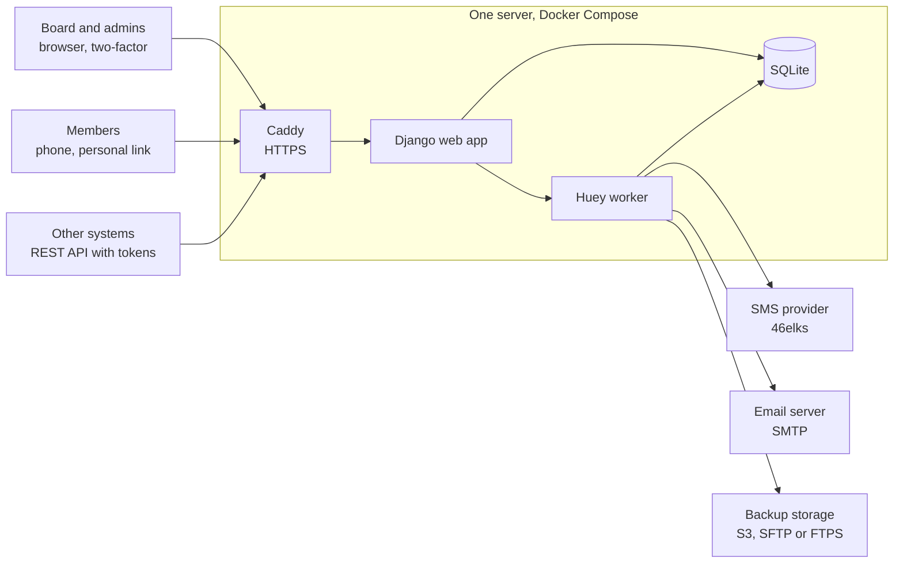

# Architecture

Agreed plan for Metra, October 2026. Changes to the decisions
below need the maintainer's approval.

## Summary

One open source web app in **Python with Django and SQLite**, shipped as a
Docker Compose bundle that runs on a small VPS or a Raspberry Pi. Every part
is free software; the only unavoidable running cost is SMS, which every
provider charges per message.

Django gives us, well tested and for free: login with roles and two-factor,
an admin interface, database migrations, translations (Swedish and English
first, then a machine-translated Finnish, others later) and a mature REST API toolkit. That leaves our effort
for what makes the product useful: configurable records, annual readings,
invoicing and messaging.

The water association is the first configuration, not the design. A
"household with a meter that reports yearly usage and pays a yearly fee" is
set up through settings, so a sports club or a small company can configure
their own record types instead.

## Stack and hosting

Three containers in one Docker Compose file: the web app, a background
worker and a Caddy reverse proxy that handles HTTPS automatically. Web app
and worker share one data volume holding the SQLite databases and uploads.

Everything personal stays on the organisation's own server; the worker only
hands outgoing messages and encrypted backups to outside services.

| Part | Choice | Why |
| --- | --- | --- |
| Language and framework | Python 3.13, Django 5.2 LTS | Login, roles, admin, migrations and translations built in |
| User interface | Server-rendered pages with HTMX | Fast to build, no separate frontend project, works on phones |
| Database | SQLite in WAL mode | No database server to run, JSON fields for custom data, one file to back up |
| Background jobs | Huey with SQLite storage | Sends SMS, email and backups, and runs scheduled jobs, without Redis |
| API | Django REST Framework with an OpenAPI description | Other systems read and write records with tokens |
| PDFs | WeasyPrint | Invoices and letters from HTML templates, for email and print |
| Backups | rclone, triggered by the worker | One tool covers S3, SFTP and FTPS, with encryption |
| Web server | Caddy | Free HTTPS certificates with no setup |
| Licence | MIT | Anyone can use, change and self-host it |

Running cost for a 50-household association is a small VPS (or hardware they
already own) plus SMS credits.

PostgreSQL would only pay off with many simultaneous writers or one install
hosting many organisations. Django hides most database differences, so a
later switch is a settings change plus a data migration.

## Data model

The model separates **what is registered** (a household, a member, a client
company) from **who you contact** (people), so one household can have
several contacts and one person can belong to several units.

| Entity | Holds | Water example |
| --- | --- | --- |
| Organisation | Name, business ID, VAT number, bank account, language, invoice settings | The water company |
| Unit type | A configurable kind of record, with its own custom fields | "Household" with "Property ID" and "Meter number" |
| Unit | One registered thing: name, address, status, start and end dates, custom field values | Household at Byvägen 4 |
| Person | Name, email, phone, address, preferred channel, consents | The owner and a co-owner |
| Role | Links a person to a unit: owner, billing contact, contact | Owner receives invoices |
| Tag or group | Free labels for filtering and mailing lists | "Village north", "Board" |
| Reading type and reading | A periodic value with unit, period and who submitted it | Yearly water usage in m³ |
| Fee plan | A recurring charge: amount, interval, VAT, which units it applies to | Base fee per year plus price per m³ |
| Invoice, line, payment | Numbered invoices, reference numbers, paid status | Annual invoice 2026 |
| Message and campaign | Sent SMS, emails and newsletters with delivery status | Spring meter-reading reminder |
| Audit log | Who changed or viewed what, and when | GDPR accountability |

Custom fields are defined by an admin (text, number, date, choice, yes/no)
and stored as validated JSON on the unit or person. That is how the same app
serves a water company, a club or a small business without code changes.

## Modules

Each module is a separate Django app, so an organisation can switch off what
it does not use (for example invoicing).

1. **Register.** Searchable, filterable list of units and people; add, edit
   and archive; CSV import and export; roles for admin, board, treasurer and
   read-only.
2. **Readings and self-service.** Each year the app sends every household a
   personal link by SMS or email. The member opens it on their phone, enters
   the meter value and can check their own contact details. No member
   passwords; links expire.
3. **Messaging.** SMS or email to everyone, a tag or a filtered list, with
   templates and placeholders. A provider interface keeps SMS vendors
   swappable.
4. **Newsletters.** Composed in the app, sent by email in throttled batches,
   with an unsubscribe link and consent tracked per person.
5. **Invoicing.** Fee plans generate invoices per period, adding usage-based
   lines from readings. Each invoice gets a sequential number and a bank
   reference, renders to PDF, and goes out by email or to a print batch.
   Payments are marked manually, or imported from a bank file later.
6. **API and integrations.** REST API with scoped tokens, outgoing webhooks
   on events (member added, invoice paid), exports for bookkeeping software.
7. **Backups.** Nightly encrypted copy of the SQLite file (taken with
   SQLite's online backup while the app runs) plus uploads, pushed to
   S3-compatible storage, SFTP or FTPS. Last backup status on the dashboard
   and a documented restore command.
8. **Privacy tools.** Export everything about one person, erase or
   anonymise them, and run retention rules automatically.

## Nordic compliance

GDPR is the main law to design for and is the same in all Nordic countries;
bookkeeping and invoicing rules differ per country and become settings.
These points are from general knowledge, not legal advice, and must be
checked before the first real installation.

| Area | What the app does |
| --- | --- |
| GDPR legal basis | Each data field has a documented purpose. Membership data rests on the membership agreement; marketing needs consent. |
| Data subject rights | One-click export of a person's data, correction through self-service, erasure or anonymisation when no other law requires keeping it. |
| Accountability | Audit log of changes and data views, a processing record template, role-based access so only the treasurer sees invoices. |
| Security | HTTPS only, two-factor login for admins, encrypted backups, hashed passwords, no data to third parties without a configured processor. |
| Data location | Self-hosted by default. Recommended SMS, email and backup providers are EU-based. |
| Bookkeeping retention | Sent invoices and payments are locked and kept for the country's period, approximately: Finland 6 years for vouchers and 10 for books, Sweden 7, Norway 5, Denmark 5. Other personal data is deleted earlier. |
| Invoice content | Sequential numbering, seller business ID and VAT number, VAT per rate, due date, national reference number (Finnish reference, Swedish OCR, Norwegian KID, Danish FIK). Optional SEPA payment QR code. |
| E-invoicing | Not needed for households. A later Finvoice or Peppol integration covers business clients who demand e-invoices. |
| Newsletters and SMS marketing | Consent recorded with date and source, unsubscribe in every message, service messages kept separate from marketing. |
| Accessibility | WCAG 2.1 AA, so the self-service form works with screen readers and on phones. |

Åland is outside the EU VAT area, so VAT settings must allow an organisation
to be VAT-exempt or use different rules per installation.

## SMS and email providers

SMS starts with **46elks** (Sweden, pay per message, simple REST API) and
email with plain **SMTP**, both behind a small provider interface so an
installation can switch with a setting. Alternatives: GatewayAPI (Denmark)
or Sinch (Sweden) for SMS; Brevo or Mailjet (France, free tiers) for
newsletters.

## Roadmap

```mermaid
flowchart TD
    p1[Phase 1: Foundation<br/>register, custom fields, roles, two-factor, audit log,<br/>CSV import and export, Docker install, offsite backups]
    p2[Phase 2: Annual readings<br/>reading rounds, member self-service links, reminders]
    gate{{Pilot with the water association}}
    p3[Phase 3: Messaging<br/>SMS and email to groups, newsletters with consent]
    p4[Phase 4: Invoicing<br/>fee plans, usage lines, numbered PDF invoices, email and print]
    p5[Phase 5: Messaging and setup<br/>email a unit, attachments, setup wizard, deliverability]
    p6[Phase 6: Integrations as plugins<br/>REST API, webhooks;<br/>46elks SMS moves to a plugin]
    p7[Phase 7: Restore, help and meetings<br/>restore from backups in the app, help pages,<br/>meeting protocols plugin, notifications]
    p8[Phase 8: Plugins and sending in the app<br/>plugin chooser, email and SMS settings,<br/>Mailgun plugin]
    p9[Phase 9: Bookkeeping plugin<br/>simple double-entry books for small associations]
    p11[Phase 11: Orchestrator<br/>separate tool metra-admin: many installs, deploy, upgrades, demos]
    p12[Phase 12: Support plugin, postponed<br/>time-limited, audited access to help with setup]
    p1 --> p2 --> gate --> p3 --> p4 --> p5 --> p6 --> p7 --> p8 --> p9 --> p11
    p11 -.-> p12
```

The API is built into every phase, since pages and API share models and
permissions; phase 6 opens it to outside systems.

| Phase | Status |
| --- | --- |
| 1 to 4 | Done. Alongside them: alerts, a public page, Finnish, the rename to Metra, a new layout with a dark theme, and READMEs in three languages |
| 5 | A to C done (email a unit, attachments, setup wizard). D, email deliverability, is replaced by phase 8 |
| 6 | Done: plugin groundwork, 46elks SMS, REST API and webhooks as plugins (release 0.2.0) |
| 7 | Done: snapshots, restore in the app, help pages, meeting protocols plugin, notifications |
| 8 | Done: plugin chooser and plugin settings, email settings in the app, the Mailgun add-on and 46elks settings in the app (releases 0.3.0 to 0.5.0). Since then also a left sidebar menu |
| 9 | Done: ledger, postings from Metra, financial statements, budget and VAT summary, locking and year-end, and exports and retention. See the [phase 9 build plan](history/build-plans.md#phase-9-build-plan) |
| 10 | Parked: country rules for Sweden moved to [might-do-later.md](might-do-later.md#sweden) |
| 11 | In use: the orchestrator is its own repository, `metra-admin` (Metra plus its `hosting` add-on), with its own roadmap. Version 0.2.5 runs on the server and manages the installs there, including the water association and the public demo. Its bookkeeping phase can start now that phase 9 is done |
| 12 | Postponed, not a priority: to be planned later |

Ideas taken off the plan for now are in [might-do-later.md](might-do-later.md).

## Later phases

Outlines only; each becomes a build plan when it is next. The build plans
of finished phases are in [history/build-plans.md](history/build-plans.md).

- **Phase 9: Bookkeeping plugin.** See the
  [phase 9 build plan](history/build-plans.md#phase-9-build-plan).
- **Phase 10: Sweden.** Parked; see
  [might-do-later.md](might-do-later.md#sweden).
- **Phase 11: Orchestrator.** In use; the plan and its status are in
  `ROADMAP.md` in the `metra-admin` repository. A separate tool in its own repository that
  runs many Metra installations, so an organisation can sign up and get
  its own install without the maintainer's help, and so hosting can later
  be sold. Each customer keeps a separate install with its own data
  directory and SQLite database, which keeps data apart and backups simple.
  The orchestrator handles sign-up, creating, upgrading, suspending and
  deleting installs, a domain or subdomain per install, health and backup
  status, and later plans and payment. Metra itself needs only small
  additions: a command that creates an organisation and its first admin
  (sent a one-time setup link), and a way to read version and health.
- **Phase 12: Support plugin.** Postponed; not a priority, and planned
  again when it is needed. A plugin, the first in the plugins
  repository (see [Plugins](#plugins)), that lets
  the maintainer help an organisation set up its install. The
  organisation's admin grants support access from a page in the app, for
  a limited time and with a role they choose; support signs in with their
  own account and two-factor login, never a shared password, and access
  ends by itself or when the admin revokes it. Everything support does is
  in the audit log under their name, and a banner shows staff when
  support access is open. Admins can also send a help request with the
  page they were on. It works on a standalone install and through the
  orchestrator, which can list the installs that have granted access.

## Plugins

Organisations can extend the app without forking it.

- **A plugin is a normal Python package** that can be installed with pip and
  is a Django app.
- **Discovery and enabling.** Plugins are found through the Python entry
  point group `metra.plugins` and enabled per installation with
  `METRA_PLUGINS`, a comma-separated list. Nothing loads unless it is listed.
- **Docker.** The image installs extra packages listed in
  `METRA_PLUGIN_PACKAGES` at build time, or the user builds a derived image
  `FROM` ours.
- **Django integration.** Settings appends the enabled plugins to
  `INSTALLED_APPS`, so their migrations, templates, static files and
  translations work as for any app.
- **Hook registry.** A small in-house registry, with no new dependency, gives
  named extension points:
  - navigation items
  - panels on unit and person pages
  - custom field types
  - SMS and email providers
  - backup targets
  - CSV import and export formats
  - reading validators
  - invoice line generators (phase 4)
  - API routes and webhook events (phase 6)

  For model events, plugins use ordinary Django signals.
- **Trust.** Plugins run with full trust, like any other installed code.
  Only install plugins you trust. A plugin must declare which personal data
  it stores, so the export and erasure tools cover it.
- **Example.** A minimal example plugin lives in the repository
  (`plugins/example`) and is used in the tests.

How to install, enable and write plugins is in [plugins.md](plugins.md).

Official plugins that are not part of the core are built as separate
Python packages under `plugins/` in this repository, one package per
plugin, each installable with pip and tested against the current Metra
release. They depend on the core only through the hook registry and
public models, so they can later move to their own plugins repository
without changes. Phase 6 starts this: the API (`metra-api`) and webhooks
(`metra-webhooks`) are built as plugins, and the 46elks SMS provider moves out of the core
into a plugin too. The core keeps the provider interface, the console
and dummy providers, and SMTP email.
Plugins import only `apps.plugins.api`. The support plugin in phase 12 is
built the same way. The example plugin stays here because the core
tests use it.

The plugin core ships in phase 2 (PR 10) with the first extension points:
navigation, unit and person panels, and messaging providers. Every later
phase adds its own extension points as it builds the feature they hook into.
